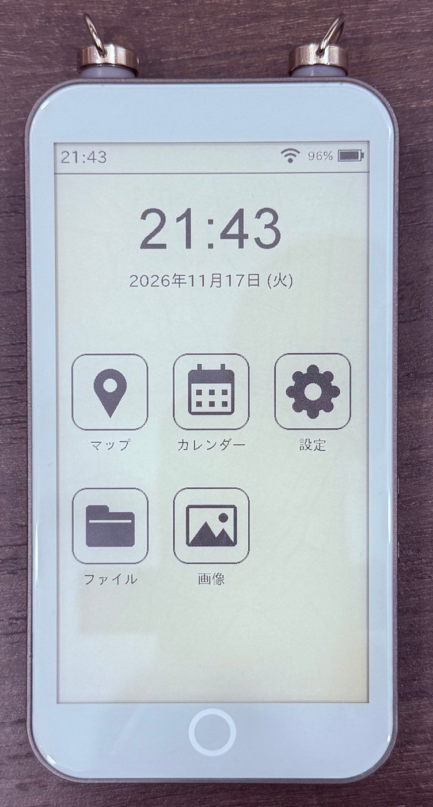
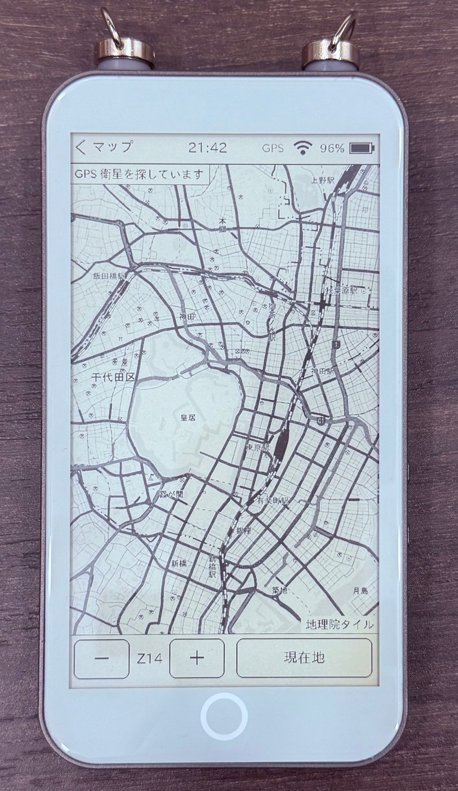
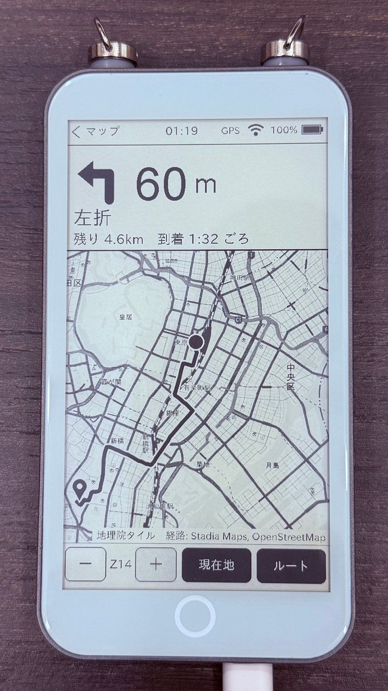
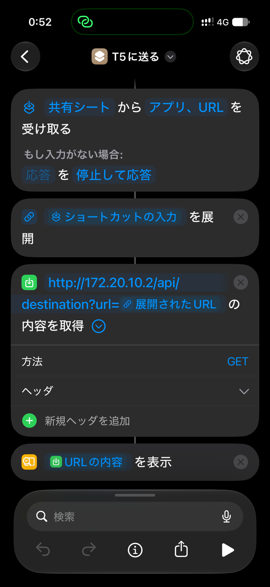

# t5-epaper-navi

LilyGO T5 E-Paper S3 Pro（4.7 インチ電子ペーパー、ESP32-S3）向けのファームウェア。

<p>
  
  
  
  
</p>

左からホーム画面、マップ、ルート案内、ロック画面。マップの写真は「ルート」ボタンを足す前のもの。地図の出典は国土地理院（地理院タイル）、経路の出典は Stadia Maps と OpenStreetMap。

スマホ風のホーム画面から、次のアプリを起動できる。

| アプリ | できること |
|---|---|
| マップ | 国土地理院の地図を表示し、内蔵 GPS の現在位置を重ねる。見た場所の地図は SD カードに保存され、WiFi のない場所でも表示できる。目的地までの経路を重ねる「ルート案内」（50cc の原付向け） |
| カレンダー | 月表示のカレンダー |
| ファイル | SD カードの中身の一覧と削除。PC やスマホのブラウザからファイルを出し入れする「WiFi 転送」 |
| 画像 | SD カード上の JPEG / PNG / BMP を表示し、ロック画面の画像に設定する |
| 設定 | WiFi、フロントライト、スリープまでの時間、時刻合わせ、画面の濃さなど |

表示は日本語。細かい仕様は [SPEC.md](SPEC.md) にある。

## 必要なもの

- **LilyGO T5 E-Paper S3 Pro**（基板 H752-01。GPS 内蔵・タッチパネル付きのモデル）
- **microSD カード**（FAT32）。地図の保存、画像の表示、ファイルの転送に使う
- **WiFi**（2.4GHz）。地図のダウンロードと時刻合わせに使う
- ルート案内を使う場合は、[Stadia Maps](https://stadiamaps.com/) の API キー（無料の登録で取得できる。無料プランは非商用のみ）
- **[PlatformIO](https://platformio.org/)** を入れた PC と USB ケーブル

ほかの T5 シリーズ（Pro でないモデルなど）では動作を確認していない。

## ビルドと書き込み

```sh
pio run                  # ビルド
pio run -t upload        # 書き込み
pio device monitor       # シリアルログ
```

書き込めないときは、BOOT ボタンを押したまま背面の RST を押して離し、最後に BOOT を離してダウンロードモードにする。

## 使い方

### ボタン

| 操作 | 動作 |
|---|---|
| 画面下のホームキー | どのアプリからでもホーム画面に戻る |
| 画面左上の「<」 | 1 つ前の画面に戻る |
| BOOT ボタン | 起きているときはロックしてスリープ。スリープ中は復帰 |

一定時間操作しないと、ロック画面の画像を表示してスリープする。
スリープ中は画面のタッチやホームキーでは復帰しない（消費電流を抑えるため）。

### 最初にすること

1. SD カードを入れて電源を入れる。
2. 「設定」→「WiFi」で接続先を選び、パスワードを入力する。接続すると時刻が自動で合う。
3. 「マップ」を開く。表示している範囲の地図がダウンロードされ、SD カードに保存される。

### 地図を SD カードに入れる

地図を PC で用意して SD カードに入れる必要はない。WiFi につながった状態で「マップ」を開けば、表示した範囲の地図が自動でダウンロードされ、SD カードに保存される。

WiFi のない場所で使いたいときは、出かける前に WiFi のある場所で、使う範囲を使う縮尺で一度表示しておく。保存されるのは表示した範囲と縮尺の分だけで、縮尺を変えると別の地図が必要になる。

[m5-navi](https://github.com/bishi-eava/m5-navi) で使っていた SD カードがあれば、保存済みの地図をそのまま使える（保存場所と形式が同じ）。

#### 全国の地図をまとめて入れる

広い範囲を WiFi なしで使いたい場合は、PC で全国の地図をまとめてダウンロードし、SD カードにコピーする方法もある。ダウンロードには [gsij_tile_downloader](https://github.com/bishi-eava/gsij_tile_downloader)（Python 製）が使える。

1. PC で gsij_tile_downloader を実行する。実行したフォルダに `std` フォルダができ、その中に `縮尺/x/y.png` の形で地図が保存される。
2. `std` フォルダの中の縮尺のフォルダ（`8`、`12`、`14` など）を、SD カードの `/cyberjapandata.gsi.go.jp/xyz/std/` にコピーする。`std/tmp` と、同時に作られる `std_jpg` フォルダはコピーしなくてよい。

このツールは範囲を選べず、指定した縮尺の全国分を取得する。最初の設定では縮尺 8・12・14 が対象で、あわせて約 60 万枚、約 8GB になる。これとは別に、実行のたびに約 1.1GB の目録ファイルをダウンロードする。

本体が使う縮尺ごとの量は次のとおり（2026 年 11 月時点の標準地図の目録から集計）。

| 縮尺（ズームレベル） | 枚数 | 容量 |
|---|---|---|
| 7 | 約 1.6 万枚 | 約 0.1GB |
| 8 | 約 6.6 万枚 | 約 0.3GB |
| 12 | 約 4.1 万枚 | 約 0.5GB |
| 14 | 約 49 万枚 | 約 7.4GB |
| 16 | 約 299 万枚 | 約 27GB |

縮尺 7 と 16 は最初の設定に含まれない。対象の縮尺を変えるには、スクリプトの `target_zoom_levels` を書き換える。縮尺 16 の全国分は枚数が多いので、必要な場所を本体で表示して保存するほうが現実的。

大量の地図を一度に取得するので、国土地理院のサーバーに負担をかけないよう、必要なときだけ実行する。ダウンロードした地図は自分で使うためのもので、他人に配布する場合は「地図データについて」にある手続きが関わる。

### ルート案内

マップに、目的地までの経路を重ねて表示する。経路は 50cc の原付（原付一種）向けで、高速道路を通らず、所要時間を 30km/h で見積もる。案内の表示は、位置を仮に置き換えて実機で確かめたところまでで、実際に走っての確認はまだ（「動作確認の状況」を参照）。

経路は目安として使い、現地の標識と交通規制を必ず優先する。次の限界がある。

- 自動車専用道路や原付通行禁止の区間は、経路のもとになる地図データ（OpenStreetMap）に登録がある場合だけ避ける。登録が漏れている道は経路に入る。試したところ、名阪国道（自動車専用道路）を通ると見られる経路が出た。
- 二段階右折、渋滞、通行止めは考慮しない。
- 出発前に「全体を表示」で経路を見て、通れない道がないかを確かめる。

#### 準備（最初の 1 回）

1. [Stadia Maps](https://stadiamaps.com/) に登録して、API キーを作る。
2. 本体に API キーを入れる。次のどちらかで行う。
   - 「設定」→「ルート案内」で、画面のキーボードから入力する。
   - 「ファイル」→「WiFi 転送」でブラウザの画面を開き、「ルート案内の API キー」に貼り付ける。キーが長いので、こちらが楽。

#### 経路を引く

経路の取得には通信が要る。出先では、スマホのテザリングを「設定」→「WiFi」に登録しておく。

1. 「マップ」→「ルート」→「地図で目的地を選ぶ」を押し、地図上の目的地をタップする。
2. 確認の表示で「経路を引く」を押す。出発地は GPS の現在地になる。測位できていないときは、直前に見ていた場所を出発地にするかを尋ねる。
3. 経路の全体が表示される。「現在地」を押すと、現在地を追いながら案内する。

取得した経路は SD カードに保存され、そのあとは WiFi がなくても案内できる。スリープから復帰しても続きから案内する。

- 経路がある間は、地図の上部に案内の帯が出る。走行中に一目で読めるよう、曲がる向きの矢印と、そこまでの距離を大きく表示する。その下に、曲がる向きと進む先の道路名、目的地までの残り距離と到着の見込み時刻が並ぶ。
- 帯の距離は、地図の描き直しを待たずに 2 秒おきに更新する。地図そのものの描き直しは、これまでどおり最短 10 秒おき。
- GPS が測位できていない間は「GPS 探索中」と経路の全長だけになる。
- 地図は北が上のまま動く。進行方向が上になるようには回らないので、曲がる向きは帯の矢印で確かめる。
- 案内中に「現在地」が有効な間は、現在地を、進む向きの反対側に寄せて表示する。進む先を広く見せるため。南へ進むときは上寄り、北へ進むときは下寄りになる。
- 帯は、地図をずらして経路の線が画面の外に出ても消えない。経路がある間は「ルート」ボタンが黒地に白文字になる。消すには「ルート」→「案内をやめる」を押す。
- 経路から 50m 以上離れると、帯が「ルート外」に変わる。「再検索」を押すと、現在地から引き直す（通信が要る）。
- 案内中で「現在地」が有効な間は、操作しなくてもスリープしない。BOOT ボタンを押せばスリープする。
- 保存できる経路は 1 本で、取得から 7 日たつと自動で消える（Stadia Maps の規約による）。「ルート」→「案内をやめる」でも消える。

#### スマホから目的地を送る

マップを開いていて WiFi につながっている間、本体は同じ WiFi の機器から目的地を受け付ける。受け取ると画面に確認が出て、「経路を引く」を押すまでは何も変わらない。

- 送り先のアドレスは、「ルート」のメニューに `http://（本体の IP アドレス）/` の形で表示される。
- 屋外では、本体をスマホのテザリングにつなぐ。テザリングの親機になっているスマホからも送れる（iPhone で確認）。iPhone では「インターネット共有」の「互換性を優先」をオンにする（本体が 2.4GHz にしか対応していないため）。
- アドレスは、つなぐ WiFi によって変わる。家の WiFi とテザリングでは別のアドレスになる。

送り方は 3 つある。

**地図アプリの「共有」から送る（iPhone）**

iPhone の「ショートカット」アプリで、次のショートカットを 1 つ作っておく。Google マップで地点を長押しして「共有」から送れることを、iPhone で確かめた。

1. 「ショートカット」アプリで「＋」を押し、名前を付ける（例: T5 に送る）。
2. 「URL を展開」を追加し、入力に「ショートカットの入力」を選ぶ。一番上に入力を受け取る行が増えるので、「共有シート」から「URL」を受け取る設定にする。
3. 「URL の内容を取得」を追加する。URL の欄に `http://（本体の IP アドレス）/api/destination?url=` と入力し、そのすぐ後ろに変数「展開された URL」を入れる。方法（GET）などの設定は変えなくてよい。
4. 「コンテンツを表示」（iOS によっては「結果を表示」）を追加し、表示する対象に「URL の内容」を選ぶ。本体からの返事が表示される。

<p>
  
</p>

設定例。アドレスの `172.20.10.2` は、本体を iPhone のテザリングにつないだときのもの。本体の「ルート」のメニューに出るアドレスに合わせる。

使うときは、本体でマップを開いておき、地図アプリで場所を「共有」して、このショートカットを選ぶ。「目的地を受け取りました。本体の画面で確認してください。」と出れば届いている。

**ブラウザで貼り付けて送る**

ブラウザで本体のアドレスを開くと、送信の画面が出る。Google マップで地点を長押しして出る座標（`35.658034, 139.701636` の形）か、展開済みの共有リンクを貼り付けて送る。

**プログラムから送る**

`/api/destination` に送る。POST のフォーム形式でも、GET でアドレスの後ろに付ける形（`/api/destination?ll=35.658034,139.701636`）でもよい。場所は次のどれかで指定する。`name`（名前）は省略できる。

| 指定 | 内容 |
|---|---|
| `url` | 地図アプリの共有リンク。短縮リンクは、展開したあとのものを送る |
| `ll` | 「緯度, 経度」をまとめた文字列（十進の度） |
| `lat` と `lon` | 緯度と経度（十進の度） |

共有リンクは、リンクの中に座標が入っているものだけ読める。座標のないリンクや、短縮リンクのままのものは、読み取れなかった旨を返す。

- 確かめたもの: Google マップで地点を長押しして共有したリンク、Apple マップで名前付きの場所を共有したリンク
- 確かめていないもの: Google マップで店や駅などの名前付きの場所を共有したリンク、Yahoo! マップの共有リンク（想定した形で試しただけ）

### ファイルを出し入れする（WiFi 転送）

1. 「ファイル」→「WiFi 転送」を開く。本体が WiFi の親機になる。
2. 画面の QR コードを順に読むか、表示された WiFi 名とパスワードでつないで、ブラウザで `http://192.168.4.1/` を開く。
3. ブラウザから、アップロード、ダウンロード、名前の変更、削除、フォルダ作成ができる。

転送画面を閉じると親機は止まり、ふだんの WiFi 接続に戻る。

最初の WiFi 名は `t5-epaper`、パスワードは `12345678`。このパスワードは公開されている値なので、転送中は近くにいる人もつなげる。他人につながれたくない場合は、「設定」→「WiFi 転送」でパスワードを変える。

### ロック画面の画像

「画像」で画像を開き、「ロック画面に設定」を押す。
画面は縦 540x960 ピクセル、白黒 16 階調。この大きさのグレースケール画像を用意すると、そのまま全画面に表示される。

## 地図データについて

地図には[国土地理院の地理院タイル](https://maps.gsi.go.jp/development/ichiran.html)（標準地図）を使っている。

- 地図データはこのリポジトリに含まれない。本体が表示のたびに国土地理院のサーバーから取得し（SD カードに保存済みならそれを使う）、白黒 16 階調に変換して表示する。地図画面の右下に出典（地理院タイル）を表示している。
- 取得したタイルは、SD カードの `/cyberjapandata.gsi.go.jp/xyz/std/{z}/{x}/{y}.png` に保存し、次回からはそれを使う。保存したタイルを本体が自動で消すことはない。
- 地理院タイルの利用は[国土地理院コンテンツ利用規約](https://www.gsi.go.jp/kikakuchousei/kikakuchousei40182.html)に従う。標準地図は測量法の基本測量成果にあたり、保存したタイルを第三者に配布する場合などは、測量法に基づく申請が必要になることがある。詳しくは[国土地理院の地図の利用手続](https://www.gsi.go.jp/LAW/2930-index.html)を参照。
- 地図や、地図が写った画面写真を公開するときは、出典（国土地理院または地理院タイル）を明記する。

## 経路データについて

ルート案内の経路は、[Stadia Maps](https://stadiamaps.com/) の経路検索から取得する。経路のもとになる地図データは [OpenStreetMap](https://www.openstreetmap.org/copyright)（© OpenStreetMap contributors）。

- 経路データはこのリポジトリに含まれない。API キーは利用者が自分で取得して本体に入れる。
- 経路を表示している間は、地図画面の右下に経路の出典（Stadia Maps、OpenStreetMap）を表示している。
- Stadia Maps の無料プランは非商用に限られる。取得した結果を端末に保存できるのは 7 日までで、本体はこれに合わせて自動で消す。利用は [Stadia Maps の利用規約](https://stadiamaps.com/terms-of-service/)に従う。

## 動作確認の状況

すべての機能を実装済み。実機で確認できているのは次のとおり。

- 確認済み: 起動、WiFi の自動接続、NTP 同期と RTC への書き込み、SD カードの読み書き、地図の表示・ズーム・移動・タイルのダウンロード、GPS 機種の判別、カレンダー、設定、本体情報の表示、ファイラーと画像ビューワーの操作、ルート案内のうち経路の取得・地図への表示・再起動後の再開・案内の終了・同じ WiFi の PC からの目的地の受信、iPhone のテザリングにつないだ本体へのその iPhone からの接続、iPhone のショートカットによる Google マップと Apple マップの「共有」からの送信、ルート案内の表示（次に曲がる地点、残り距離、ルートから外れたときの表示と再検索、到着。調査用コンソールで位置を仮に置き換えて確認）
- 未確認: GPS の測位（屋外での確認が必要）、スリープ電流、実際に走りながらのルート案内（GPS の精度や、画面の書き換えの間隔が実用になるか）、案内中のバッテリーの持ち

## 開発者向け

### 調査用コンソール

USB シリアル（115200bps）にコマンドを 1 行ずつ送ると、画面を見ずに動作を確かめられる。

| コマンド | 動作 |
|---|---|
| `shot` | 画面の内容を 16 進文字列で出力する |
| `tap X Y` | タップを送る |
| `drag X Y DX DY` | ドラッグを送る |
| `home` | ホームキーを送る |
| `info` | SD カード、WiFi、GPS、メモリの状態を出力する |
| `gps LAT LON` | 測位した位置を置き換える（屋内で案内の表示を確かめる用）。`gps off` で元に戻す |
| `routekey KEY` | ルート案内で使う経路サービスの API キーを保存する |
| `dest LAT LON` | マップに目的地の候補を渡す（スマホから受け取ったときと同じ扱い） |

### ソース構成

| ファイル | 内容 |
|---|---|
| `src/board.*` | ハードウェア制御（画面、タッチ、電源、RTC、SD、スリープ） |
| `src/ui.*` | ステータスバー、アプリ切り替え、ボタン、ソフトウェアキーボード |
| `src/net.*` | WiFi 接続と時刻同期 |
| `src/gps.*` | 内蔵 GPS の受信と機種判別 |
| `src/route.*` | ルート案内の経路（経路サービスからの取得、SD カードへの保存、現在地との照合） |
| `src/webfiles.*` | WiFi 転送（アクセスポイントとファイル用の HTTP サーバー） |
| `src/safewrite.*` | SD カードへの確実な書き込み（結果を確かめ、失敗したら書き直す） |
| `src/debug.*` | シリアル経由の調査用コンソール |
| `src/settings.*` | 本体に保存する設定値 |
| `src/apps/` | 各アプリ |

## ライセンス

このリポジトリのソースコードは [MIT ライセンス](LICENSE)で公開する。

ビルド時に PlatformIO が次のライブラリを取得して組み込む。これらはこのリポジトリに含まれず、それぞれのライセンスに従う。

| 名称 | 用途 | ライセンス |
|---|---|---|
| [Arduino core for ESP32](https://github.com/espressif/arduino-esp32) | 開発の土台（WiFi、SD カード、HTTP など） | LGPL-2.1 |
| [M5GFX](https://github.com/m5stack/M5GFX) | 描画、画像デコード | MIT |
| M5GFX 内蔵の日本語フォント（IPA フォントを変換したもの） | 画面の文字 | IPA フォントライセンス v1.0 |
| [SensorLib](https://github.com/lewisxhe/SensorLib) | タッチ、RTC | MIT |
| [TinyGPSPlus](https://github.com/mikalhart/TinyGPSPlus) | GPS の解析 | LGPL-2.1 |
| [ArduinoJson](https://github.com/bblanchon/ArduinoJson) | 経路データの読み書き | MIT |

ビルドしたファームウェア（`.bin`）を配布する場合は、上のライブラリが組み込まれるので、各ライセンスの条件に従う必要がある。

ボード定義（`boards/T5-ePaper-S3.json`）は、LilyGO の公式リポジトリ [T5S3-4.7-e-paper-PRO](https://github.com/Xinyuan-LilyGO/T5S3-4.7-e-paper-PRO) のものを使っている。ピン配置も同リポジトリの資料による。

地図データのライセンスは「地図データについて」を、経路データは「経路データについて」を参照。
